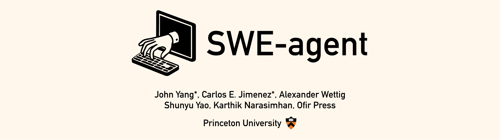

<p align="center">
  <a href="https://swe-agent.com/latest/">
    
  </a>
</p>

> 本文件是 [README.md](README.md) 的简体中文翻译。代码、命令、链接与 BibTeX 引用保持原文，专有名词（如 SWE-agent、mini-SWE-agent、SWE-bench、EnIGMA 等）保留英文。

<p align="center">
<a href="https://swe-agent.com/latest/"></a>
<a href="https://swe-bench.slack.com"></a>
<a href="https://arxiv.org/abs/2405.15793"></a>
</p>

<p align="center">
  <a href="https://github.com/SWE-agent/mini-swe-agent/">
    
  </a>
</p>

> [!warning]
> 我们当前的开发重心主要在 [mini-swe-agent](https://github.com/SWE-agent/mini-swe-agent/) 上，
> 它已经取代了 SWE-agent。它在性能上与 SWE-agent 相当，实现却要简洁得多。
> 关于两者差异的更多细节，请查阅 [FAQ](https://mini-swe-agent.com/latest/faq/)。
> 总体而言，我们建议大家后续使用 mini-SWE-agent 而非 SWE-agent。


SWE-agent 让你所选用的语言模型（例如 GPT-4o 或 Claude Sonnet 4）能够自主地使用工具，从而
[修复真实 GitHub 仓库中的问题](https://swe-agent.com/latest/usage/hello_world)、
[发现网络安全漏洞](https://enigma-agent.com/)，或
[执行任意自定义任务](https://swe-agent.com/latest/usage/coding_challenges)。

* ✅ 在开源项目的 SWE-bench 成绩中处于**最先进水平（state of the art）**
* ✅ **自由流畅且可泛化**：将最大的自主权交给语言模型
* ✅ **可配置且文档完善**：由单个 `yaml` 文件统一管理
* ✅ **为研究而生**：设计上简单且易于改造

SWE-agent 由来自普林斯顿大学和斯坦福大学的研究人员构建并维护。

## 📣 动态

* 7 月 24 日：[Mini-SWE-Agent](https://github.com/SWE-agent/mini-SWE-agent) 仅用 100 行 Python 便在 SWE-bench verified 上取得 65%！
* 5 月 2 日：[SWE-agent-LM-32b](https://github.com/SWE-bench/SWE-smith) 在 SWE-bench 上取得开源权重 SOTA
* 2 月 28 日：[SWE-agent 1.0 + Claude 3.7 在 SWE-Bench full 上达到 SoTA](https://x.com/KLieret/status/1895487966409298067)
* 2 月 25 日：[SWE-agent 1.0 + Claude 3.7 在 SWE-bench verified 上达到 SoTA](https://x.com/KLieret/status/1894408819670733158)
* 2 月 13 日：[发布 SWE-agent 1.0：在 SWE-bench light 上达到 SoTA 并带来大量新功能](https://x.com/KLieret/status/1890048205448220849)
* 12 月 7 日：[对 SWE-agent 与 SWE-bench 团队的一次访谈](https://www.youtube.com/watch?v=fcr8WzeEXyk)

## 🚀 立即开始！

👉 在浏览器中试用 SWE-agent：[](https://codespaces.new/SWE-agent/SWE-agent)（[更多信息](https://swe-agent.com/latest/installation/codespaces/)）

阅读我们的[文档][docs]以了解更多：

* [安装](https://swe-agent.com/latest/installation/source/)
* [从命令行开始的上手示例](https://swe-agent.com/latest/usage/hello_world/)
* [在 SWE-bench 上进行基准评测](https://swe-agent.com/latest/usage/batch_mode/)
* [常见问题（FAQ）](https://swe-agent.com/latest/faq/)

[docs]: https://swe-agent.com

## 面向攻击性网络安全的 SWE-agent（EnIGMA） <a name="enigma"></a>

</img>

[SWE-agent: EnIGMA][enigma] 是一种用于解决攻击性网络安全（夺旗 CTF）挑战的模式。
EnIGMA 在多个网络安全基准上取得了最先进的结果（参见 [leaderboard](https://enigma-agent.com/#results)）。
在我们为 1.0 更新 EnIGMA 期间，请暂时使用 [SWE-agent 0.7](https://github.com/SWE-agent/SWE-agent/tree/v0.7)。

[enigma]: https://enigma-agent.com
[SWE-bench]: https://github.com/SWE-bench/SWE-bench
[nyu-ctf]: https://arxiv.org/abs/2406.05590

此外，你可能也会对我们的其他项目感兴趣：


<div align="center">
  <a href="https://github.com/SWE-agent/mini-SWE-agent"></a>
   &nbsp;&nbsp;
  <a href="https://github.com/SWE-agent/SWE-ReX"></a>
   &nbsp;&nbsp;
  <a href="https://github.com/SWE-bench/SWE-bench"></a>
  &nbsp;&nbsp;
  <!-- <a href="https://github.com/SWE-agent/SWE-agent"></a> -->
  <a href="https://github.com/SWE-bench/SWE-smith"></a>
  &nbsp;&nbsp;
  <a href="https://github.com/SWE-bench/sb-cli"></a>
</div>

## 贡献 <a name="contributions"></a>

如果你希望为代码库做出贡献，我们欢迎你来提交 [issue](https://github.com/SWE-agent/SWE-agent/issues) 和 [pull request](https://github.com/SWE-agent/SWE-agent/pulls)！对于较大的代码改动，我们始终鼓励先在 issue 中展开讨论。

## 引用与联系 <a name="citation"></a>

SWE-agent 是一个学术项目，由 John Yang*、Carlos E. Jimenez*、Alexander Wettig、Kilian Lieret、Shunyu Yao、Karthik Narasimhan 和 Ofir Press 在普林斯顿大学发起。
联系人：[John Yang](https://john-b-yang.github.io/)、[Carlos E. Jimenez](http://www.carlosejimenez.com/) 和 [Kilian Lieret](https://www.lieret.net/)（邮箱：johnby@stanford.edu、carlosej@cs.princeton.edu、kl5675@princeton.edu）。

如果这项工作对你有所帮助，请考虑使用以下内容进行引用：

<details>
<summary> SWE-agent citation</summary>

```bibtex
@inproceedings{yang2024sweagent,
  title={{SWE}-agent: Agent-Computer Interfaces Enable Automated Software Engineering},
  author={John Yang and Carlos E Jimenez and Alexander Wettig and Kilian Lieret and Shunyu Yao and Karthik R Narasimhan and Ofir Press},
  booktitle={The Thirty-eighth Annual Conference on Neural Information Processing Systems},
  year={2024},
  url={https://arxiv.org/abs/2405.15793}
}
```
</details>

如果你使用了其中的摘要器（summarizer）、交互式命令或攻击性网络安全能力，也请考虑引用：

<details>
<summary>EnIGMA citation</summary>

```bibtex
@misc{abramovich2024enigmaenhancedinteractivegenerative,
      title={EnIGMA: Enhanced Interactive Generative Model Agent for CTF Challenges},
      author={Talor Abramovich and Meet Udeshi and Minghao Shao and Kilian Lieret and Haoran Xi and Kimberly Milner and Sofija Jancheska and John Yang and Carlos E. Jimenez and Farshad Khorrami and Prashanth Krishnamurthy and Brendan Dolan-Gavitt and Muhammad Shafique and Karthik Narasimhan and Ramesh Karri and Ofir Press},
      year={2024},
      eprint={2409.16165},
      archivePrefix={arXiv},
      primaryClass={cs.AI},
      url={https://arxiv.org/abs/2409.16165},
}
```
</details>


## 🪪 许可证 <a name="license"></a>
MIT。请查看 `LICENSE`。


<div align="center">

[](https://github.com/SWE-agent/SWE-agent/actions/workflows/pytest.yaml)
[](https://github.com/SWE-agent/SWE-agent/actions/workflows/build-docs.yaml)
[](https://codecov.io/gh/SWE-agent/SWE-agent)
[](https://results.pre-commit.ci/latest/github/SWE-agent/SWE-agent/main)
[](https://github.com/SWE-agent/SWE-agent/actions/workflows/check-links-periodic.yaml)

</div>
